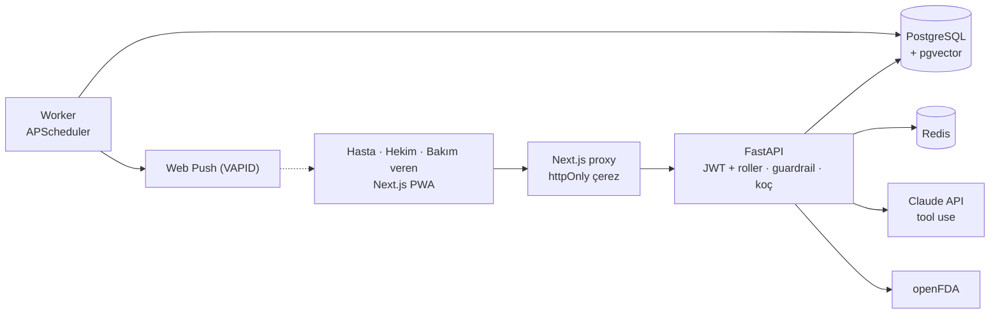

# İlaç Uyumu ve Yaşam Tarzı Koçu

Tip 2 diyabet ve hipertansiyon hastalarının ilaç ve ölçüm takibini yaptığı, LLM koçun **tıbbi tavsiye vermeden** kişiselleştirilmiş, veriye dayalı ve kaynaklı geri bildirim verdiği, hekim için uyum dashboard'u sunan sağlık platformu.

> ⚠️ Koç teşhis koymaz ve ilaç dozu önermez. Acil durumlarda **112**'yi arayın. Proje yalnızca sentetik demo verisiyle çalışır.

Proje tanımı: [docs/PROJE_TANIMI.md](docs/PROJE_TANIMI.md)

## Durum

| Teslim | Tarih | Durum |
|---|---|---|
| M1 — Öneri + Mimari | 23 Eki 2026 | 🟡 Hazırlanıyor ([docs/M1](docs/M1)) |
| M2 — Veritabanı + Backend | 13 Kas 2026 | ⏳ |
| M3 — Arayüz MVP | 11 Ara 2026 | ⏳ |
| M4 — Yapay Zekâ Bileşeni | 1 Oca 2027 | ⏳ |
| M5 — Final Rapor + Demo | 17 Oca 2027 | ⏳ |

## M1 belgeleri

| Belge | İçerik |
|---|---|
| [01 — Proje önerisi](docs/M1/01-proje-onerisi.md) | Problem, hedef, kapsam, roller, teknoloji seçimi, riskler, teslim planı |
| [02 — Guardrail politikası](docs/M1/02-guardrail-politikasi.md) | Koçun asla yapmadıkları, 3 katmanlı kontrol, acil belirti kategorileri, sabit yanıtlar |
| [03 — Veri gizliliği](docs/M1/03-veri-gizliligi.md) | KVKK ilkeleri, rol bazlı erişim matrisi, LLM'e giden veri, güven sınırları |
| [04 — Kullanıcı akışları](docs/M1/04-kullanici-akislari.md) | Hasta, hekim, bakım veren ve acil belirti akışları |
| [05 — Sistem mimarisi](docs/M1/05-mimari.md) | Bağlam, bileşen, koç/hatırlatma/openFDA dizileri, dağıtım, tasarım kararları |
| [06 — ER diyagramı (taslak)](docs/M1/06-er-diyagrami.md) | Planlanan veri modeli |

## Mimari (özet)

Ayrıntı: [docs/M1/05-mimari.md](docs/M1/05-mimari.md)

## Teknoloji yığını

| Katman | Teknoloji |
|---|---|
| Frontend | Next.js (PWA), TypeScript, Recharts, shadcn/ui |
| Backend | FastAPI, SQLAlchemy, Alembic, APScheduler, pywebpush |
| LLM | Claude API (tool use + structured output), pgvector (RAG) |
| Altyapı | PostgreSQL, Redis, Docker Compose, GitHub Actions |
