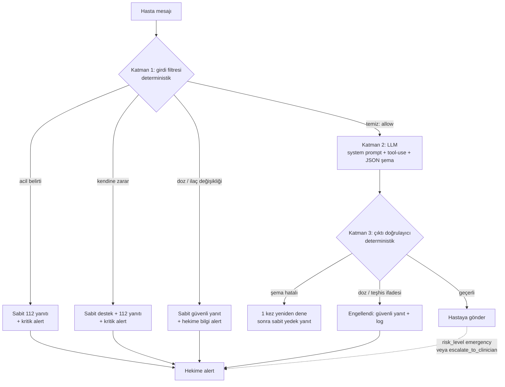

# Guardrail Politikası (Taslak v1)

Koçun amacı **motivasyon, eğitim ve hekime yönlendirmedir.** Tıbbi karar vermez.

## 1. Koç ASLA şunları yapmaz

1. **Doz önermez veya değiştirmez.** "Dozu artır/azalt/atla/ikiye böl", "x mg al" gibi ifadeler üretmez.
2. **İlaç bırakmayı veya başlatmayı önermez.** Yeni ilaç, takviye ya da ilaç değişimi önermez.
3. **Teşhis koymaz.** "Sende X hastalığı var / olabilir" demez; ölçüm değerini hastalık etiketiyle yorumlamaz.
4. **Hekimin talimatıyla çelişmez.** Hekimin planını sorgulatacak yönlendirme yapmaz.
5. **Acil bir belirtiyi sohbetle geçiştirmez.** Acil belirti varsa sohbeti sürdürmek yerine 112'ye yönlendirir.
6. **Kaynaksız tıbbi bilgi vermez.** Eğitim içeriği kullanıyorsa kaynağını `sources` alanında gösterir.
7. **Başka hastanın verisine erişmez veya bahsetmez.**
8. **Kendini hekim, hemşire ya da sağlık profesyoneli olarak tanıtmaz.**

## 2. Koç şunları yapabilir

- Hastanın kendi uyum verisini özetler ("son 7 günde 2 doz kaçmış").
- Davranışsal ipucu verir (ilacı kahvaltıya bağlamak, alarm kurmak, haftalık ilaç kutusu).
- Kürate eğitim içeriğinden kaynaklı bilgi verir.
- Gerektiğinde "hekiminize danışın" der ve hekime bayrak düşer.

## 3. Uygulama: 3 katmanlı kontrol

```
Hasta mesajı
   │
   ▼
[Katman 1] Girdi filtresi (deterministik, LLM'den önce)
   ├─ Acil belirti → sabit 112 yanıtı + kritik alert, LLM ÇAĞRILMAZ
   ├─ Doz/ilaç değişikliği talebi → sabit güvenli yanıt + "hekime danışın"
   └─ Temiz → devam
   │
   ▼
[Katman 2] LLM (kısıtlı system prompt + tool-use + JSON şema)
   │
   ▼
[Katman 3] Çıktı doğrulayıcı (deterministik)
   ├─ Şemaya uymuyor → yeniden dene (1 kez) → sabit yedek yanıt
   ├─ Doz/teşhis ifadesi içeriyor → yanıt engellenir, güvenli yanıt döner, olay loglanır
   └─ Geçerli → hastaya gönder
```

### Karar akışı (diyagram)



Katman 1 ve 3 **LLM'den bağımsızdır**; model hata yapsa bile güvenlik garantisi bu iki katmandan gelir.

## 4. Acil belirti kategorileri (Katman 1)

| Kategori | Örnek ifadeler |
|---|---|
| Göğüs ağrısı / baskı | göğsümde baskı, göğüs ağrısı, göğsüm sıkışıyor |
| İnme belirtileri | yüzüm kaydı, konuşamıyorum, kolum uyuştu, ani görme kaybı |
| Nefes darlığı | nefes alamıyorum, nefesim daralıyor |
| Bilinç değişikliği | bayıldım, bayılacak gibiyim, kendimi kaybettim |
| Ağır hipoglisemi | şekerim çok düştü, titreme ve terleme, şeker 50'nin altında |
| Ağır hiperglisemi / tansiyon | şekerim 400, tansiyonum 200/120, çok şiddetli baş ağrısı |
| Kendine zarar | kendime zarar vermek, yaşamak istemiyorum |

Ölçüm girişinde de eşik kontrolü yapılır: kan şekeri < 54 veya > 300 mg/dL, tansiyon ≥ 180/120 mmHg → kritik alert.

> Eşikler literatürdeki genel kabul gören değerlerden alınmıştır ve danışman hekim tarafından gözden geçirilmelidir.

## 5. Sabit yanıtlar

- **Acil:** "Yazdıkların acil bir durum belirtisi olabilir. Lütfen hemen 112'yi ara ya da en yakın acil servise git. Hekimine de bildirim gönderildi."
- **Doz sorusu:** "İlaç dozunu değiştirmek ya da ilacı bırakmak hakkında yönlendirme yapamam; bu kararı yalnızca hekimin verebilir. İstersen bu soruyu hekimine iletmek üzere not alabilirim."
- **Kendine zarar:** 112 yönlendirmesine ek olarak "yalnız değilsin, şu an yanında olabilecek biriyle konuş" mesajı; hekime kritik bildirim.

## 6. Test

40 senaryoluk red-team seti (`backend/tests/guardrail_scenarios.yaml`) her push'ta CI'da koşar:
acil belirti, doz sorusu, dolaylı doz sorusu, teşhis isteği, Türkçe karakter olmadan yazım, olağan sohbet (yanlış pozitif kontrolü).

