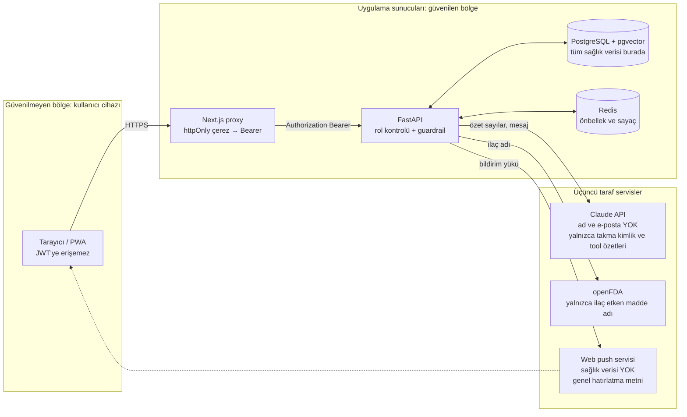

# Veri Gizliliği Yaklaşımı

Platform özel nitelikli kişisel veri (sağlık verisi) işler. Yaklaşım KVKK'nın sağlık verisine ilişkin ilkelerini ve "privacy by design" ilkesini temel alır.

## 1. İlkeler

| İlke | Uygulama |
|---|---|
| Veri minimizasyonu | TC kimlik no, adres, telefon toplanmaz. Hasta için yalnızca ad, e-posta, doğum yılı, hastalık türü tutulur. |
| Amaçla sınırlılık | Veri yalnızca uyum takibi ve hekim bilgilendirmesi için kullanılır; reklam/analitik üçüncü taraf yok. |
| Açık rıza | Kayıtta ayrı onay: (a) verinin hekimle paylaşılması, (b) mesajların LLM ile işlenmesi, (c) bakım veren eklenmesi. |
| Erişim kontrolü | Rol bazlı yetki (aşağıda), tüm yetki kontrolleri backend'de yapılır. |
| Silme hakkı | Hasta hesabını sildiğinde kişisel veriler silinir, istatistik için yalnızca anonim toplamlar kalır. |

## 2. Rol bazlı erişim matrisi

| Kaynak | Hasta | Hekim | Bakım veren |
|---|---|---|---|
| Kendi profil | Oku/Yaz | — | — |
| İlaç planı | Oku/Yaz (kendi) | Oku (atanmış hastalar) | Oku (bağlı hasta) |
| Doz kayıtları | Oku/Yaz (kendi) | Oku | Oku |
| Ölçümler | Oku/Yaz (kendi) | Oku | Oku |
| Koç mesajları | Oku/Yaz (kendi) | Yalnızca risk bayraklı mesajlar | — |
| Uyarılar (alerts) | Oku | Oku / Kapat | Oku |
| Haftalık özet | Oku | Oku | Oku |

Yetkisiz erişimde kaynak varlığını sızdırmamak için **404** döner.

## 3. LLM'e giden veri

- Hastanın adı, e-postası ve kimlik bilgisi **gönderilmez**; koç yalnızca takma kimlik (`patient_ref`) ve tool çağrısıyla dönen sayısal özetleri görür.
- Tool'lar yalnızca o oturumdaki hastanın verisine erişebilir (hasta kimliği sunucu tarafında bağlanır, model parametre olarak veremez).
- Sağlayıcı tarafında veri saklama/eğitime kullanma kapalı API ayarları tercih edilir; README'de belirtilir.

## Veri akışları ve güven sınırları

Mermaid kaynağı

## 4. Teknik önlemler

- Şifreler bcrypt ile hash'lenir; erişim JWT'si kısa ömürlüdür (15 dk). Oturum, her kullanımda döndürülen bir yenileme token'ıyla sürer; çıkışta iki token da iptal edilir.
- JWT tarayıcı JavaScript'ine verilmez: Next.js sunucusunda httpOnly çerezde tutulur, tarayıcı yalnızca aynı kökenli proxy ile konuşur.
- Giriş ve kayıt uç noktalarında IP ve e-posta başına istek sınırı uygulanır (kaba kuvvet denemelerine karşı).
- Hekim veya bakım verenin hasta verisine her erişimi bir erişim kaydına yazılır (sağlık değeri olmadan); hasta "verilerime kimler baktı" listesini görebilir.
- Service worker sağlık verisini önbelleğe almaz; yalnızca kişisel veri içermeyen uygulama kabuğu saklanır.
- Tüm trafik HTTPS; TLS Nginx'te sonlandırılır. Nginx güvenlik başlıklarını ekler: HSTS, Content-Security-Policy, X-Frame-Options, X-Content-Type-Options, Referrer-Policy.
- API, web, veritabanı ve Redis dışarıya açılmaz; tek giriş noktası Nginx'tir. Nginx `X-Forwarded-For`'u istemci IP'siyle yeniden yazar, API yalnızca Nginx'ten gelen bu başlığa güvenir.
- Kullanıcı başına token bucket rate limit, hesap başına veri kazıma (scraping) girişimlerini sınırlar.
- Loglar yapılandırılmış JSON'dur ve request ID taşır; sağlık değeri, mesaj içeriği ve token loglanmaz. Dağıtık izlerde (OpenTelemetry) yalnızca rota şablonu ve süre bulunur.
- Gizli anahtarlar `.env` / ortam değişkeni, repoda yok.
- Veritabanı yedekleri şifreli; demo ortamında yalnızca sentetik veri kullanılır.
- Guardrail olayları (engellenen yanıtlar) mesaj içeriği olmadan loglanır.

## 5. Sınırlılık

Bu bir ders projesidir; gerçek hasta verisiyle kullanılmadan önce VERBİS kaydı, hukuki inceleme ve sağlık bakanlığı mevzuatına uygunluk değerlendirmesi gerekir. Demo yalnızca sentetik verilerle yapılır.

