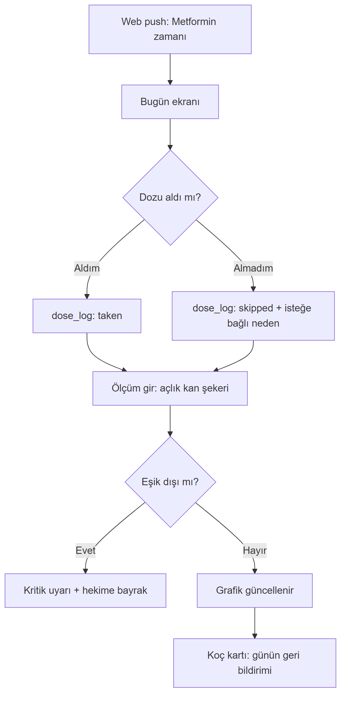
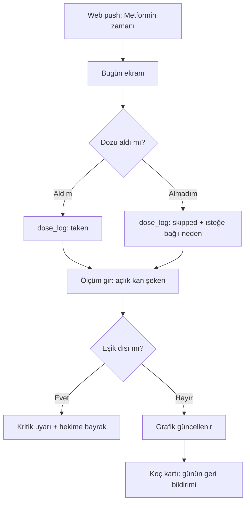
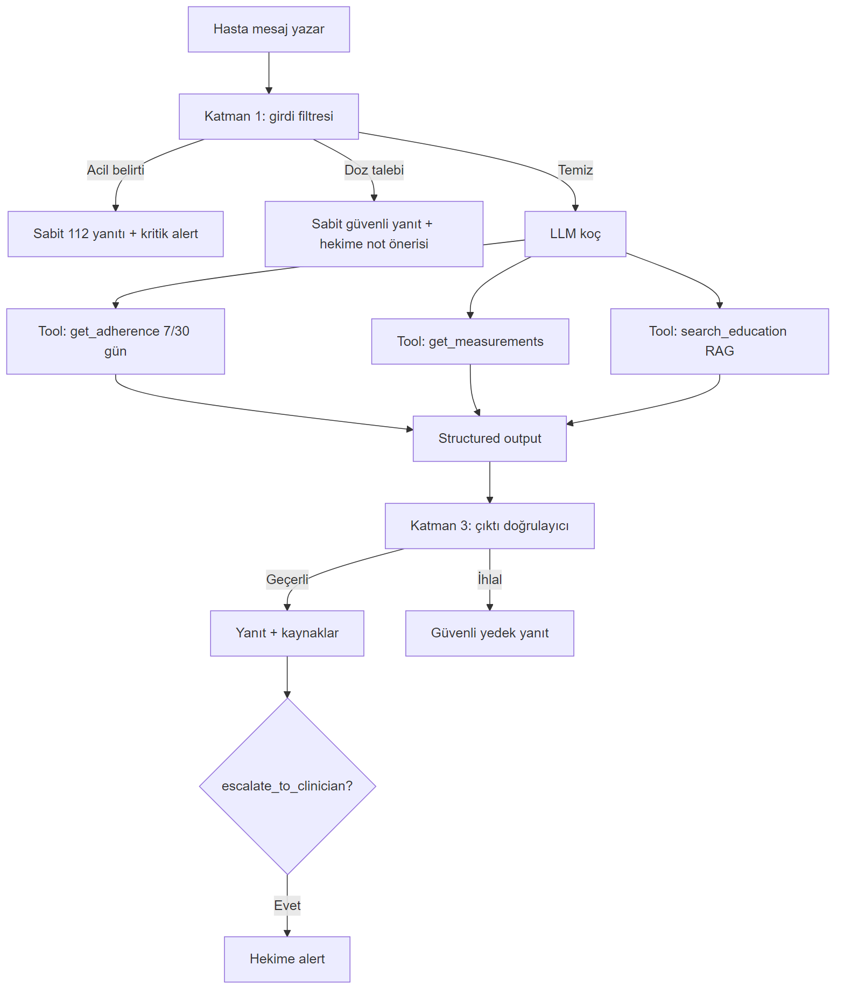
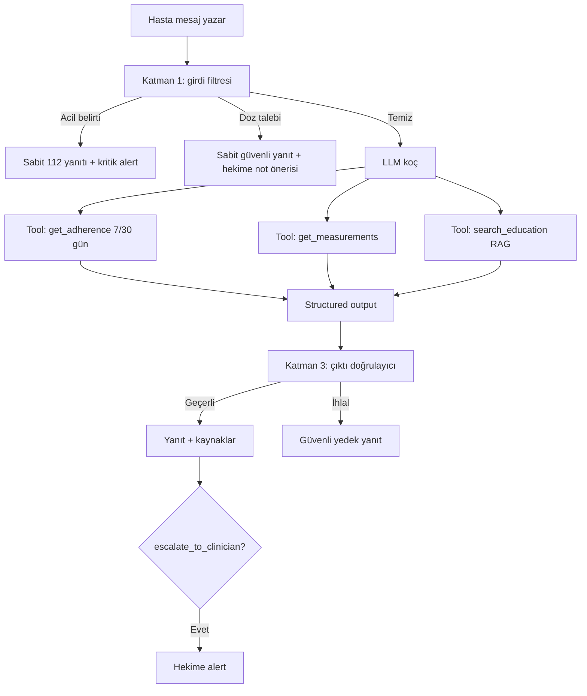
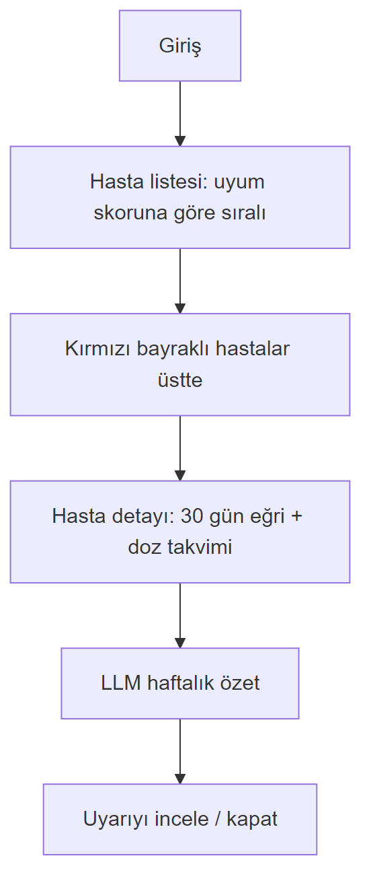
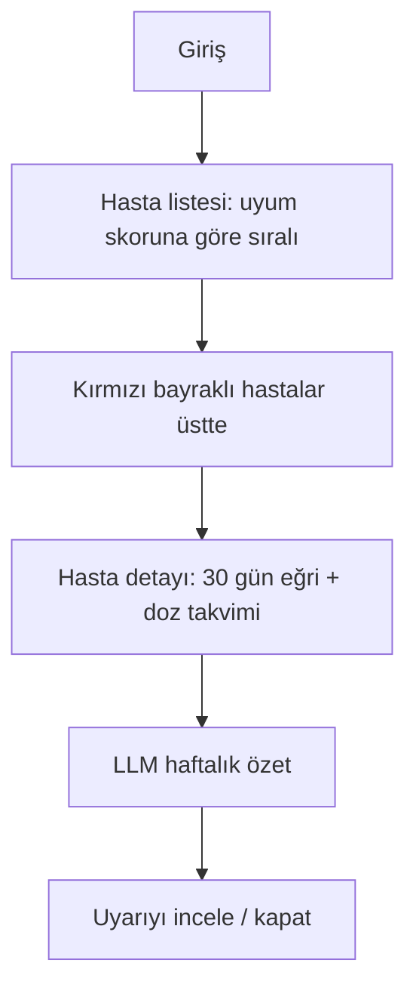
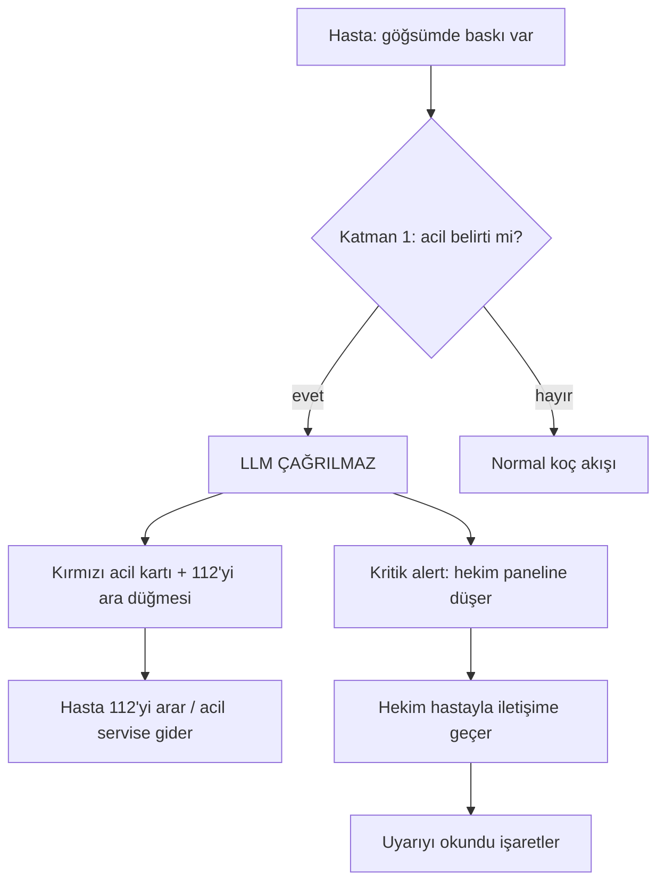
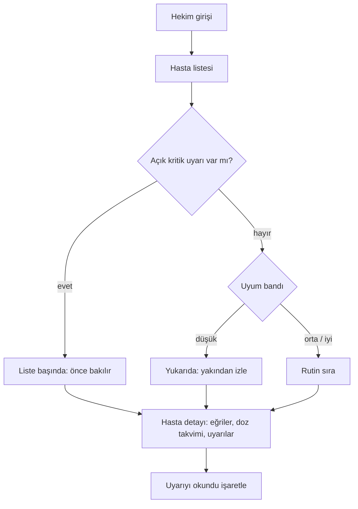
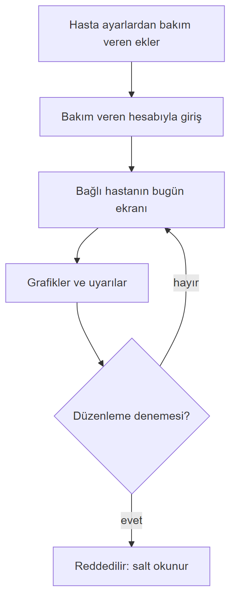
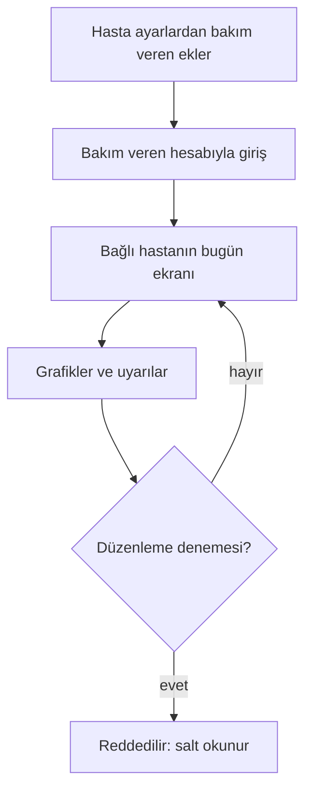

# Kullanıcı Akışları

## A. Hasta — günlük akış

Mermaid kaynağı

## B. Hasta — koç sohbeti

Mermaid kaynağı

## C. Hekim — haftalık inceleme

Mermaid kaynağı

## D. Bakım veren

Hasta, ayarlardan e-posta ile bakım veren ekler → bakım veren hesabıyla giriş yapar → bağlı hastanın bugün ekranını, grafiklerini ve uyarılarını **salt okunur** görür.

## E. Acil belirti akışı

Mermaid kaynağı

## F. Hekim — triyaj akışı

Mermaid kaynağı

## G. Bakım veren — akış

Mermaid kaynağı

