# Sistem Mimarisi

Bu belge M1 aşamasında **planlanan** mimariyi anlatır. Bileşen adları ve sınırlar M2–M5'te koda dönüşürken bu belge referans alınır; değişiklik olursa burada güncellenir.

Mimari üç soruya cevap verecek şekilde tasarlandı:

1. **Güvenli mi?** Koç tıbbi karar vermez, hasta verisi rol dışına çıkmaz (§9, [02](02-guardrail-politikasi.md), [03](03-veri-gizliligi.md)).
2. **Ölçeklenir mi?** API durumsuzdur ve yatayda çoğaltılır; önde reverse proxy + load balancer vardır (§2, §7).
3. **Dayanıklı mı?** Dış servis çökse, istek iki kez gelse, bir kopya ölse bile veri bozulmaz ve hasta acil yönlendirmeyi her koşulda alır (§4–§6).

## 1. Bağlam diyagramı

Sistemi kimler kullanır, hangi dış servislerle konuşur?

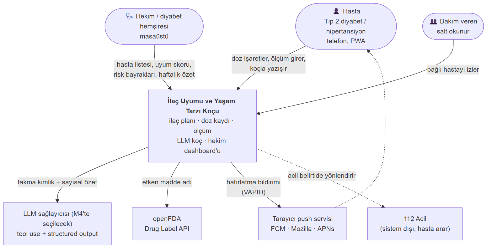

<details><summary>Mermaid kaynağı</summary>

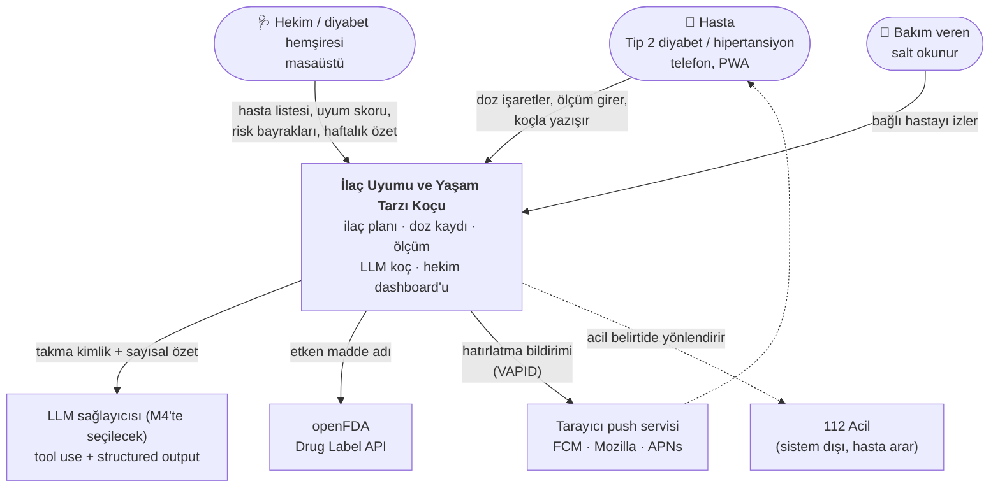

</details>

## 2. Bileşen diyagramı

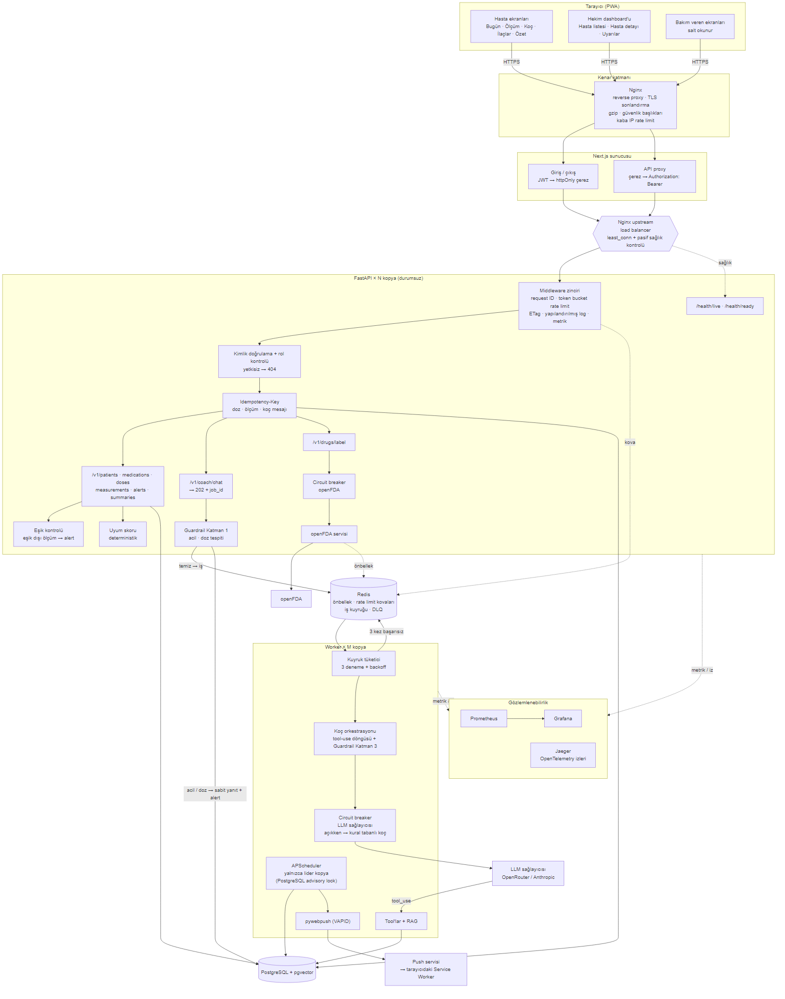

<details><summary>Mermaid kaynağı</summary>

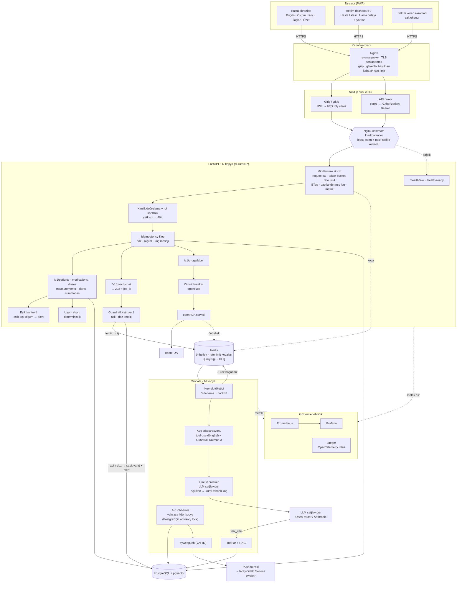

</details>

| Bileşen | Sorumluluk |
|---|---|
| Nginx (reverse proxy) | Tek giriş noktası; TLS sonlandırma, gzip, güvenlik başlıkları (HSTS, CSP, X-Frame-Options), `X-Forwarded-For`'u istemci IP'siyle yeniden yazma, IP başına kaba istek sınırı (`limit_req`) |
| Nginx upstream (load balancer) | İstekleri API kopyalarına `least_conn` ile dağıtır; hata veren kopyayı geçici olarak dışarıda bırakır (`max_fails`, `fail_timeout`) |
| Next.js proxy | Token'ı tarayıcıdan saklar; tüm API çağrılarını aynı kökenden geçirir |
| Middleware zinciri | Her isteğe request ID, kullanıcı başına token bucket rate limit, ETag / `304`, JSON log ve metrik |
| Rol kontrolü | Her istekte JWT doğrulama ve hasta-erişim kuralı; yetkisizse 404 |
| Idempotency | Aynı `Idempotency-Key` ile tekrar gelen yazma isteğine ilk yanıt aynen döner, kayıt ikinci kez oluşmaz |
| Guardrail | Katman 1 API'de (LLM'den önce, eşzamanlı), Katman 3 worker'da (LLM çıktısından sonra) |
| Koç | Worker'da LLM ile tool-use döngüsü; structured output üretir. Model yapılandırmadan seçilir (bkz. [01 §5.1](01-proje-onerisi.md#51-llm-seçimi-deneyerek-karar)) |
| Circuit breaker | Dış servis art arda hata verirse bir süre çağırmaz, doğrudan yedek yola geçer |
| Worker | Koç işleri, hatırlatmalar; başarısız iş 3 denemeden sonra DLQ'ya |
| Lider kilidi | Birden çok worker kopyasından yalnızca biri zamanlayıcıyı çalıştırır |

## 3. Bir isteğin backend katmanlarından geçişi

Örnek: hasta "aldım" düğmesine basıyor.

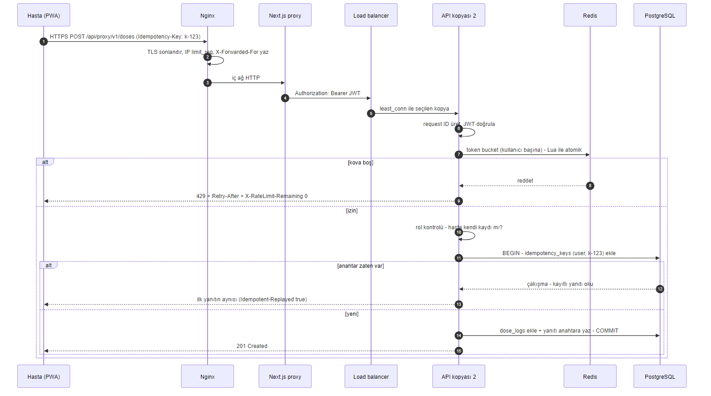

<details><summary>Mermaid kaynağı</summary>

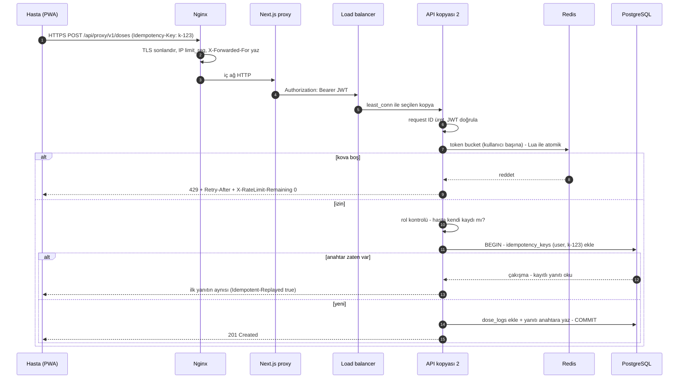

</details>

## 4. Koç isteğinin yaşam döngüsü (kuyruk + worker)

LLM çağrısı saniyeler sürebilir. API'yi bekletmemek için koç mesajı kuyruğa alınır; acil durum ise **kuyruğa hiç girmeden** API'de anında yanıtlanır.

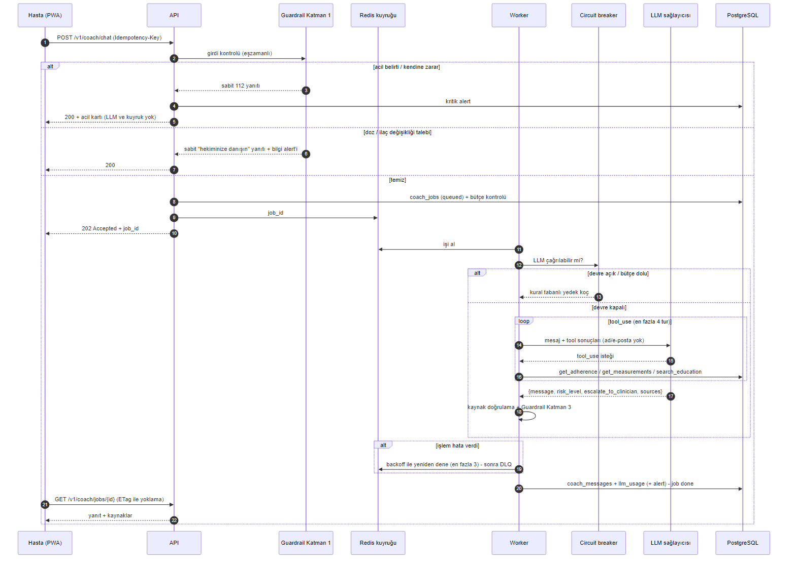

<details><summary>Mermaid kaynağı</summary>

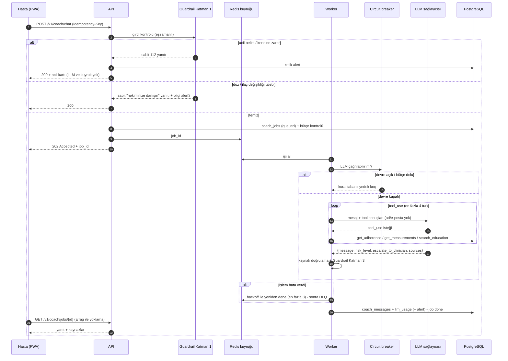

</details>

## 5. Circuit breaker durumları

LLM sağlayıcısı ve openFDA için ayrı birer devre kesici çalışır. Durum Redis'te tutulur, böylece tüm kopyalar aynı kararı paylaşır.


<details><summary>Mermaid kaynağı</summary>

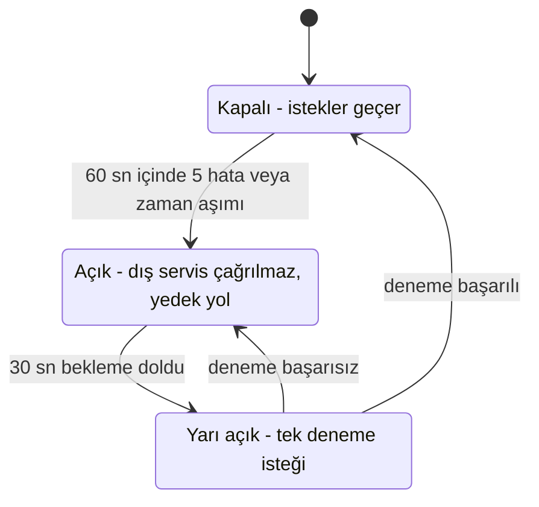

</details>

| Servis | Devre açıkken davranış |
|---|---|
| LLM sağlayıcısı | Kural tabanlı koç yanıt verir; guardrail'ler aynen geçerlidir. Haftalık özet şablon metinle üretilir. |
| openFDA | Önbellekteki son etiket döner; yoksa "ilaç bilgisi şu an alınamıyor" mesajı. |

## 6. Hatırlatma (web push) akışı

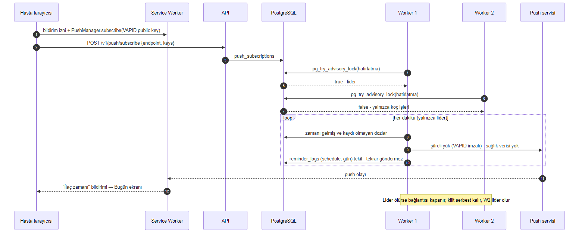

<details><summary>Mermaid kaynağı</summary>

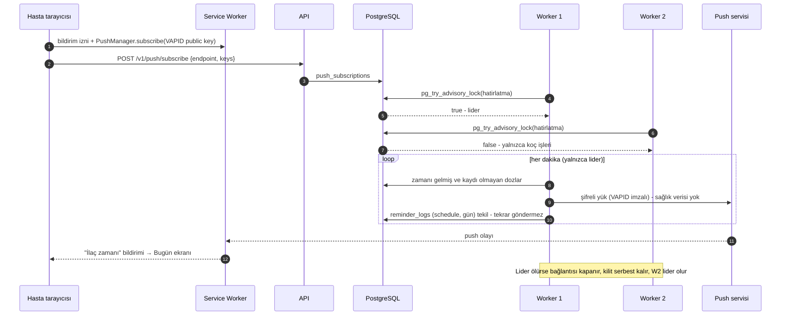

</details>

## 7. openFDA entegrasyonu


<details><summary>Mermaid kaynağı</summary>

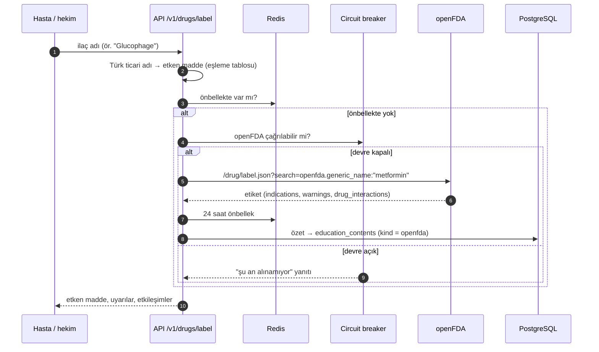

</details>

openFDA yalnızca **etken madde adıyla** sorgulanır; hastaya ait hiçbir veri dışarı gönderilmez.

## 8. Dağıtım (Docker Compose)

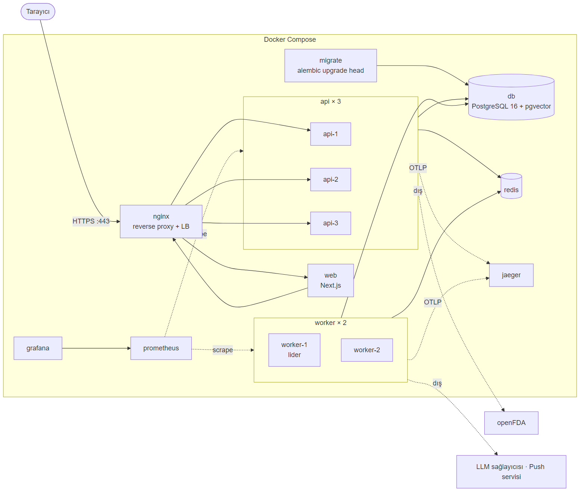

<details><summary>Mermaid kaynağı</summary>

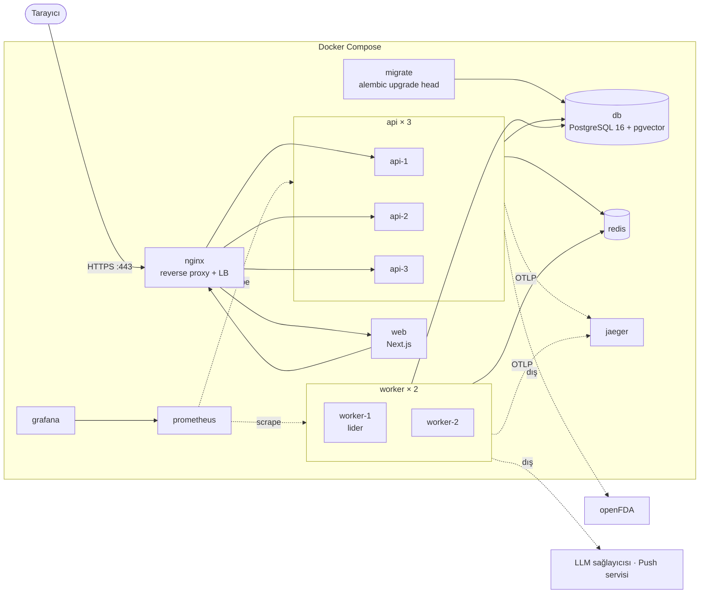

</details>

| Servis | Görev | Dışarı açık mı? |
|---|---|---|
| `nginx` | Reverse proxy, TLS, load balancer, gzip, güvenlik başlıkları | Evet (80 → 443) |
| `web` | Next.js arayüz + proxy | Hayır (Nginx arkasında) |
| `api` × 3 | Durumsuz REST API; `docker compose up --scale api=3` | Hayır |
| `worker` × 2 | Koç kuyruğu; lider olan zamanlayıcıyı da çalıştırır | Hayır |
| `migrate` | Başlangıçta şema güncelleme; api/worker bunu bekler | Hayır |
| `db` | Tüm kalıcı veri | Hayır |
| `redis` | Önbellek, rate limit kovaları, kuyruk, DLQ, devre durumu | Hayır |
| `prometheus` / `grafana` | Metrik toplama ve panolar | Yalnızca yerel |
| `jaeger` | Dağıtık iz (trace) görüntüleme | Yalnızca yerel |

**Neden yatayda ölçeklenebilir?** API kopyaları bellekte durum tutmaz: oturum JWT'de, sayaçlar/kuyruk/devre durumu Redis'te, veri PostgreSQL'de. Bu yüzden load balancer isteği herhangi bir kopyaya gönderebilir (sticky session gerekmez).

**Sıfır kesintili güncelleme:** Kopya kapanırken `SIGTERM` alır, readiness `503` döner, Nginx yeni istek göndermez, süren istekler biter (graceful shutdown). Worker o anki işi bitirmeden çıkmaz.

## 9. Ölçeklenebilirlik ve dayanıklılık özellikleri

| Kavram | Ne yapar | Bu projede neden gerekli | Teslim |
|---|---|---|---|
| Reverse proxy (Nginx) | Tek giriş noktası, TLS, gzip, güvenlik başlıkları | API ve web dışarı açılmaz; IP bilgisi güvenilir hale gelir (rate limit buna dayanır) | M2 |
| Load balancing | İstekleri API kopyalarına dağıtır | Sabah 08:00'de tüm hastalar aynı anda "aldım"a basar: tepe yük | M2 |
| Liveness / readiness | `/health/live` süreç ayakta mı; `/health/ready` DB + Redis + migration sürümü hazır mı | Hazır olmayan kopyaya trafik gitmez | M2 |
| Rate limiting (token bucket) | Kullanıcı başına kova; Redis + Lua ile atomik; `X-RateLimit-*` başlıkları | Sabit pencerenin sınır patlamasını önler; kötüye kullanım ve maliyet kontrolü | M2 |
| Idempotency-Key | Tekrarlanan yazma isteği ikinci kez kayıt oluşturmaz | Zayıf mobil bağlantıda çift "aldım" uyum skorunu bozar | M2 |
| API sürümleme | `/v1/...` | PWA güncellenmeden backend değişebilir | M2 |
| ETag / `304` | Değişmeyen yanıt tekrar gönderilmez | Hekim paneli ve koç yoklaması sık yenilenir | M3 |
| Cursor sayfalama | Liste uçlarında `?cursor=&limit=` | Ölçüm ve doz geçmişi zamanla büyür | M3 |
| Mesaj kuyruğu + worker | LLM işleri API dışında | API isteği saniyelerce bloklanmaz | M4 |
| Retry + üstel backoff | Geçici hatada yeniden dener | LLM sağlayıcısı 429 / 5xx dönebilir | M4 |
| Dead-letter queue | 3 denemeden sonra iş DLQ'ya, metrikte görünür | Sessizce kaybolan koç mesajı olmaz | M4 |
| Circuit breaker | Art arda hatada dış servisi bir süre çağırmaz | LLM sağlayıcısı veya openFDA çökerse sistem yavaşlamaz, yedek yol hemen devreye girer | M4 |
| Dağıtık kilit (lider seçimi) | PostgreSQL advisory lock | Worker çoğaltılsa da hatırlatma tek kez gider | M4 |
| Graceful shutdown | SIGTERM'de süren işi bitir | Güncelleme sırasında yarım kalan koç işi olmaz | M4 |
| Gözlemlenebilirlik | Prometheus + Grafana, JSON log + request ID, OpenTelemetry + Jaeger | Bir koç isteğinin Nginx → API → kuyruk → worker → LLM yolu tek zaman çizelgesinde görülür | M2–M5 |
| Yük testi (k6) | 1 / 3 API kopyası ile istek/sn ve p95 gecikme ölçümü | Load balancing'in etkisi raporda sayıyla gösterilir | M5 |

### Rate limit politikası (taslak)

| Uç nokta grubu | Anahtar | Limit | Katman |
|---|---|---|---|
| Tüm istekler | IP | 20 istek/sn, 40 patlama | Nginx `limit_req` |
| `/auth/login` | IP + e-posta | 5/dk (IP), 10/15 dk (e-posta) | API |
| `/auth/register` | IP | 5/saat | API |
| Yazma uçları (doz, ölçüm) | kullanıcı | 60/dk | API token bucket |
| `/coach/chat` | kullanıcı | 10/dk + günlük token bütçesi | API token bucket + bütçe |
| Okuma uçları | kullanıcı | 300/dk | API token bucket |

### Yük testi planı (M5)

- **Senaryo:** 200 sanal hasta sabah 08:00 yoğunluğunu taklit eder: giriş → bugün ekranı → "aldım" → ölçüm girişi. 20 sanal hekim paneli yeniler.
- **Karşılaştırma:** `--scale api=1` ve `--scale api=3`; istek/sn, p95/p99 gecikme, hata oranı.
- **Dayanıklılık:** Test sürerken bir API kopyası durdurulur. Beklenti: hata oranı geçici olarak artar, sonra sıfıra iner. LLM sağlayıcısı taklidi hata verdirilir. Beklenti: devre açılır, koç yedek yanıtla devam eder.
- **Başarı ölçütü:** 3 kopyada p95 < 300 ms (LLM hariç uçlar), hata oranı < %1.

## 10. Planlanan monorepo yapısı

```
ilac-uyum-kocu/
├── backend/            FastAPI uygulaması (M2)
│   ├── app/            routers · services · middleware · models · deps
│   ├── alembic/        migration'lar
│   └── tests/          pytest + guardrail_scenarios.yaml (M4)
├── frontend/           Next.js PWA (M3)
├── infra/
│   ├── nginx/          reverse proxy + upstream yapılandırması (M2)
│   ├── prometheus/     scrape yapılandırması, Grafana panoları (M2–M5)
│   └── k6/             yük testi senaryoları (M5)
├── docs/               M1–M5 belgeleri, ER diyagramı
├── docker-compose.yml  (M2)
└── .github/workflows/  CI: pytest + guardrail seti + build (M2'den itibaren)
```

## 11. Tasarım kararları

1. **Uyum skoru deterministik.** LLM skoru hesaplamaz, tool ile okur. Böylece skor test edilebilir ve her seferinde aynıdır.
2. **Güvenlik LLM'e bırakılmaz.** Girdi ve çıktı filtreleri saf kod; red-team setiyle CI'da doğrulanır. Acil yol LLM'e ve kuyruğa hiç uğramaz; API anahtarı olmasa da, worker'lar dursa da çalışır.
3. **Hasta kimliğini tool'a sunucu bağlar.** Tool şemalarında `patient_id` parametresi yoktur; model başka bir hastanın verisini isteyemez.
4. **Kaynaklar sunucuda doğrulanır.** Modelin döndürdüğü `sources`, aynı turda `search_education`'ın gerçekten döndürdüğü kayıtlarla eşleşmezse atılır.
5. **Her dış bağımlılığın yedeği var.** Bütçe dolarsa, devre açıksa veya API hata verirse kural tabanlı koç devreye girer; openFDA yoksa önbellek kullanılır.
6. **Token tarayıcıya verilmez.** httpOnly çerez + aynı kökenli proxy; XSS ile token çalınması ve CORS yüzeyi ortadan kalkar.
7. **Yetkisiz erişim 404.** 403 yerine 404 döndürülerek başka hastaların varlığı sızdırılmaz.
8. **API durumsuz.** Tüm paylaşılan durum Redis veya PostgreSQL'de; kopya sayısı yük testine göre ayarlanır.
9. **Yazma uçları idempotent.** Mobil ağda tekrar gönderim normal kabul edilir; veri bütünlüğü istemciye bırakılmaz.
10. **Tek lider zamanlayıcı.** Hatırlatmalar advisory lock'u tutan worker'dan gider; `reminder_logs` tekil kısıtı ikinci bir güvencedir.
