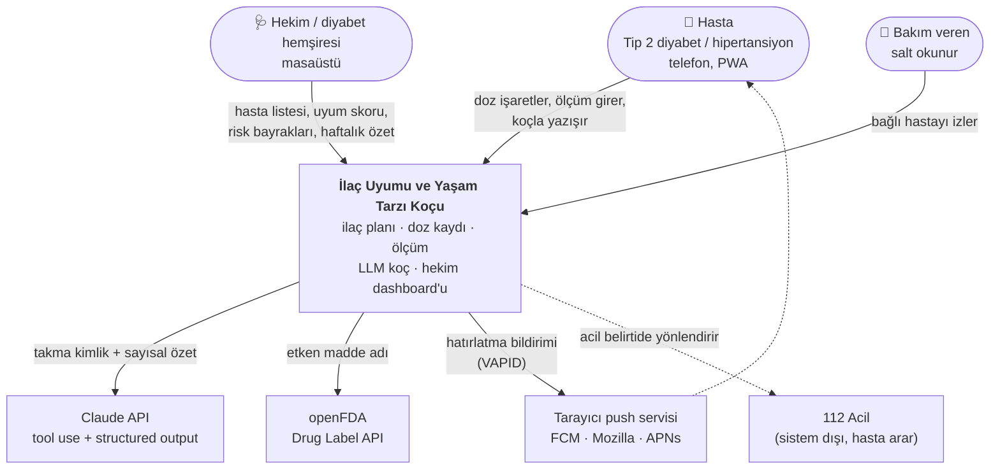
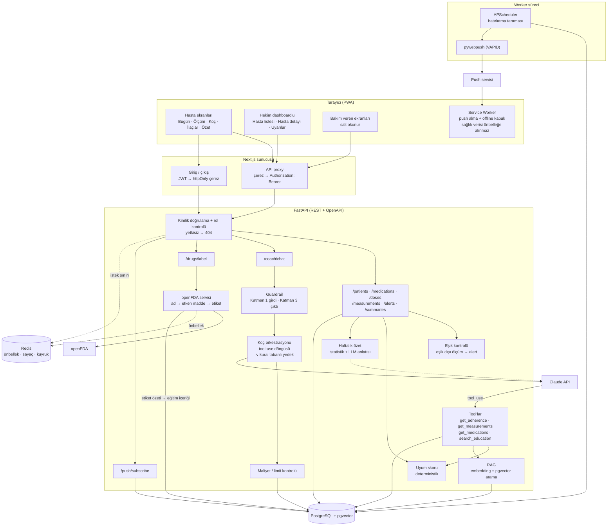
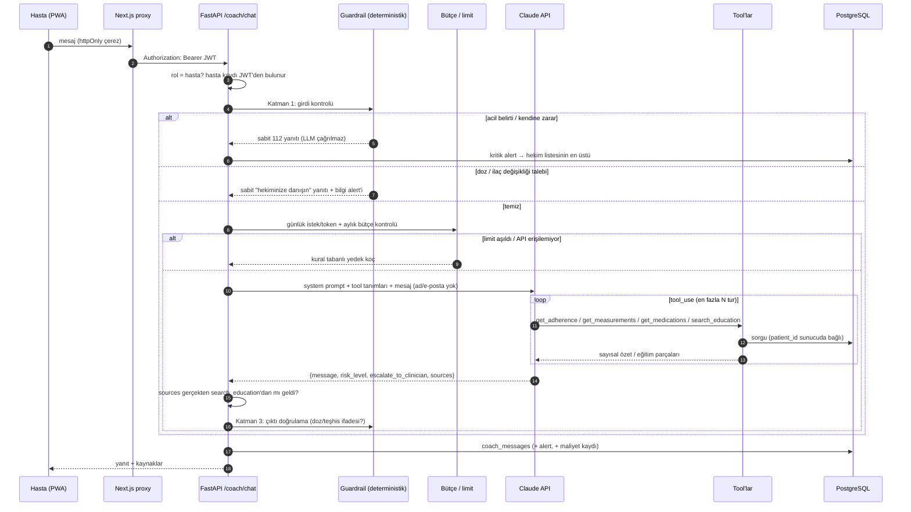
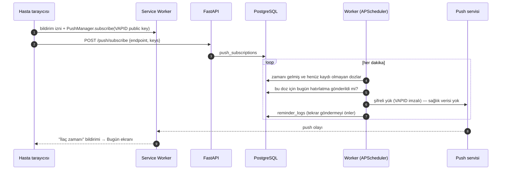
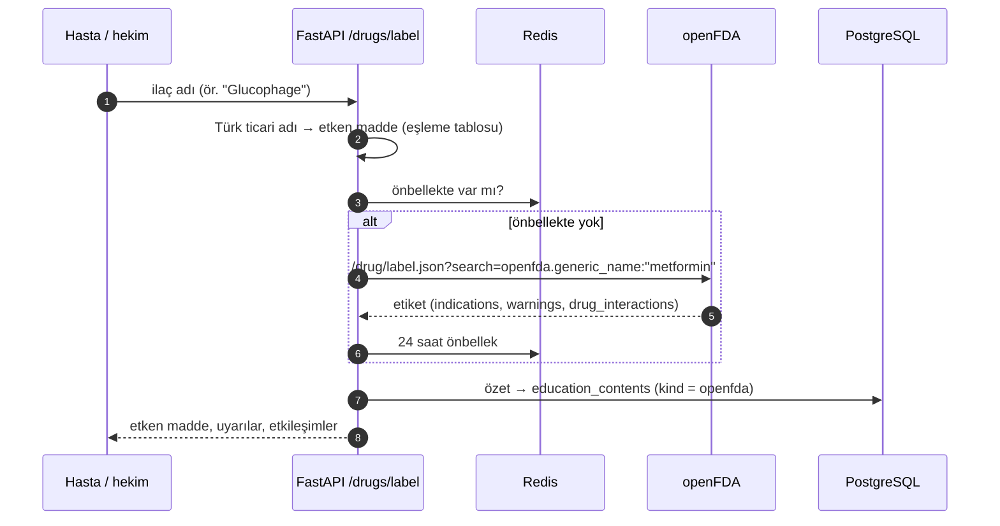
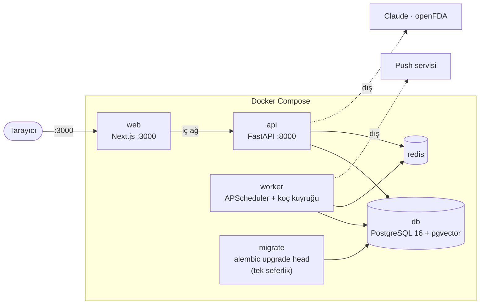

# Sistem Mimarisi

Bu belge M1 aşamasında **planlanan** mimariyi anlatır. Bileşen adları ve sınırlar M2–M4'te koda dönüşürken bu belge referans alınır; değişiklik olursa burada güncellenir.

## 1. Bağlam diyagramı

Sistemi kimler kullanır, hangi dış servislerle konuşur?


<details><summary>Mermaid kaynağı</summary>



</details>

## 2. Bileşen diyagramı


<details><summary>Mermaid kaynağı</summary>



</details>

| Bileşen | Sorumluluk |
|---|---|
| Next.js PWA | Hasta (mobil), hekim (masaüstü) ve bakım veren arayüzleri; grafikler Recharts ile |
| Next.js proxy | Token'ı tarayıcıdan saklar; tüm API çağrılarını aynı kökenden geçirir |
| Rol kontrolü | Her istekte JWT doğrulama ve hasta-erişim kuralı; yetkisizse 404 |
| Guardrail | LLM'den önce acil/doz tespiti, LLM'den sonra çıktı doğrulama |
| Koç | Claude ile tool-use döngüsü; structured output üretir |
| Uyum skoru | Planlanan ve kaydedilen dozlardan 7/30 günlük skor; LLM hesaplamaz |
| RAG | Kürate eğitim içeriği + openFDA özetleri üzerinde vektör arama |
| openFDA servisi | İlaç adından etken madde, uyarılar ve etkileşimleri çeker |
| Worker | Zamanlanmış hatırlatmalar ve uzun süren işler; API'yi bloklamaz |

## 3. Koç isteğinin yaşam döngüsü


<details><summary>Mermaid kaynağı</summary>



</details>

## 4. Hatırlatma (web push) akışı


<details><summary>Mermaid kaynağı</summary>



</details>

## 5. openFDA entegrasyonu


<details><summary>Mermaid kaynağı</summary>



</details>

openFDA yanıtı yalnızca **etken madde adıyla** sorgulanır; hastaya ait hiçbir veri dışarı gönderilmez.

## 6. Dağıtım (Docker Compose)


<details><summary>Mermaid kaynağı</summary>



</details>

| Servis | Görev | Dışarı açık mı? |
|---|---|---|
| `web` | Arayüz + proxy | Evet (3000) |
| `api` | REST API, Swagger `/docs` | Yalnızca yerel geliştirmede |
| `worker` | Hatırlatma zamanlayıcısı, uzun koç işleri | Hayır |
| `migrate` | Başlangıçta şema güncelleme | Hayır |
| `db` | Tüm kalıcı veri | Hayır (yalnızca yerel geliştirme portu) |
| `redis` | Önbellek, sayaç, kuyruk | Hayır |

## 7. Planlanan monorepo yapısı

```
ilac-uyum-kocu/
├── backend/            FastAPI uygulaması (M2)
│   ├── app/            routers · services · models · deps
│   ├── alembic/        migration'lar
│   └── tests/          pytest + guardrail_scenarios.yaml (M4)
├── frontend/           Next.js PWA (M3)
├── docs/               M1–M5 belgeleri, ER diyagramı
├── docker-compose.yml  (M2)
└── .github/workflows/  CI: pytest + guardrail seti + build (M2'den itibaren)
```

## 8. Tasarım kararları

1. **Uyum skoru deterministik.** LLM skoru hesaplamaz, tool ile okur. Böylece skor test edilebilir ve her seferinde aynıdır.
2. **Güvenlik LLM'e bırakılmaz.** Girdi ve çıktı filtreleri saf kod; red-team setiyle CI'da doğrulanır. Acil yol LLM'e hiç uğramaz, API anahtarı olmasa da çalışır.
3. **Hasta kimliğini tool'a sunucu bağlar.** Tool şemalarında `patient_id` parametresi yoktur; model başka bir hastanın verisini isteyemez.
4. **Kaynaklar sunucuda doğrulanır.** Modelin döndürdüğü `sources`, aynı turda `search_education`'ın gerçekten döndürdüğü kayıtlarla eşleşmezse atılır.
5. **Her LLM yolunun yedeği var.** Bütçe dolarsa veya API hata verirse kural tabanlı koç devreye girer; haftalık özet anlatısı üretilemezse istatistikten şablon metin oluşur.
6. **Token tarayıcıya verilmez.** httpOnly çerez + aynı kökenli proxy; XSS ile token çalınması ve CORS yüzeyi ortadan kalkar.
7. **Yetkisiz erişim 404.** 403 yerine 404 döndürülerek başka hastaların varlığı sızdırılmaz.
8. **Uzun işler worker'da.** Zamanlayıcı ve LLM araç döngüsü ayrı süreçte koşar; API birden fazla kopya çalışsa bile hatırlatma bir kez gönderilir.
