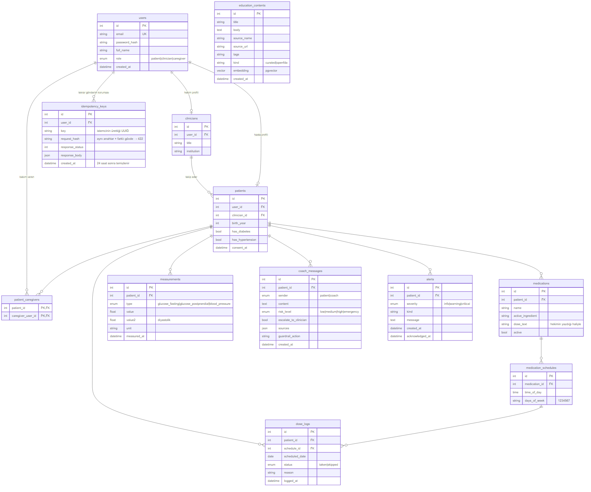
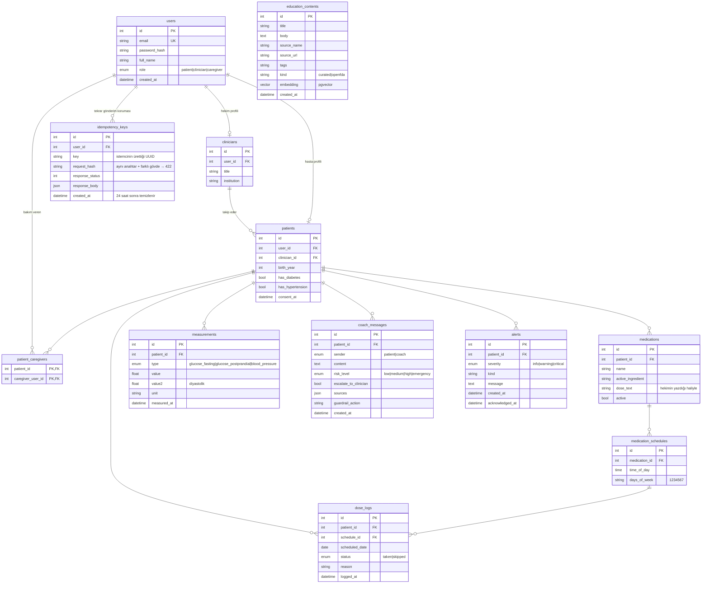

# ER Diyagramı (taslak)

M1 aşamasındaki **planlanan** veri modelidir. Proje tanımındaki 10 tabloyu (users, patients, clinicians, medications, medication_schedules, dose_logs, measurements, coach_messages, alerts, education_contents) ve bakım veren ilişkisi için bir bağlantı tablosunu içerir. Tekrar gönderimlere karşı `idempotency_keys` tablosu da plana eklenmiştir. Kesin şema M2'de Alembic migration'larıyla oluşturulacaktır; web push abonelikleri, hatırlatma kayıtları ve LLM maliyet kaydı gibi yardımcı tablolar ilgili teslimde eklenecektir.

Mermaid kaynağı

## Notlar

- `dose_logs (schedule_id, scheduled_date)` tekildir: bir planlı doz için gün başına tek kayıt.
- `medications.dose_text` hekimin yazdığı metindir; sistem bu alanı yorumlamaz ve değiştirmez (doz önerisi kapsam dışı).
- `coach_messages` koçun structured output alanlarını (`risk_level`, `escalate_to_clinician`, `sources`) ve guardrail kararını saklar; hekim yalnızca risk bayraklı mesajları görür.
- `education_contents` RAG korpusudur: `curated` kayıtlar elle seçilmiş Türkçe hasta eğitim metinleri, `openfda` kayıtları ilaç etiketlerinden üretilen özetlerdir.
- `idempotency_keys (user_id, key)` tekildir. Yazma isteği ile anahtar aynı transaction'da kaydedilir; aynı anahtar tekrar gelirse kayıtlı yanıt aynen döner (bkz. [mimari §3](05-mimari.md#3-bir-isteğin-backend-katmanlarından-geçişi)). M2'de eklenir.
- Hasta silindiğinde kişisel tüm kayıtları (cascade) silinir.
